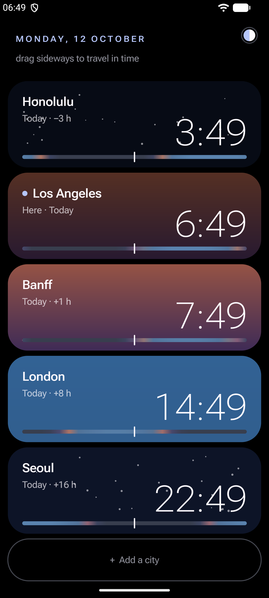
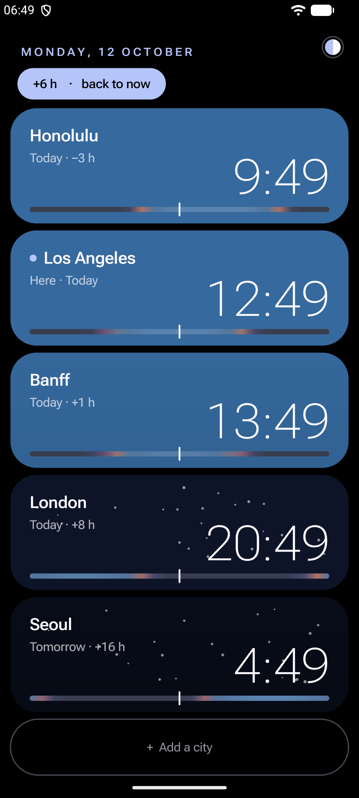
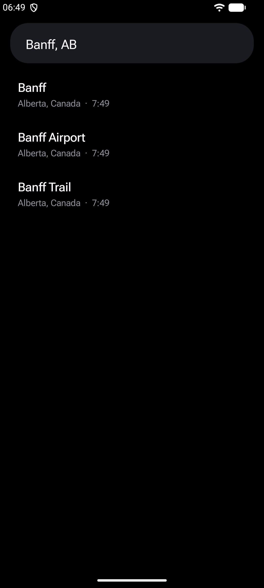
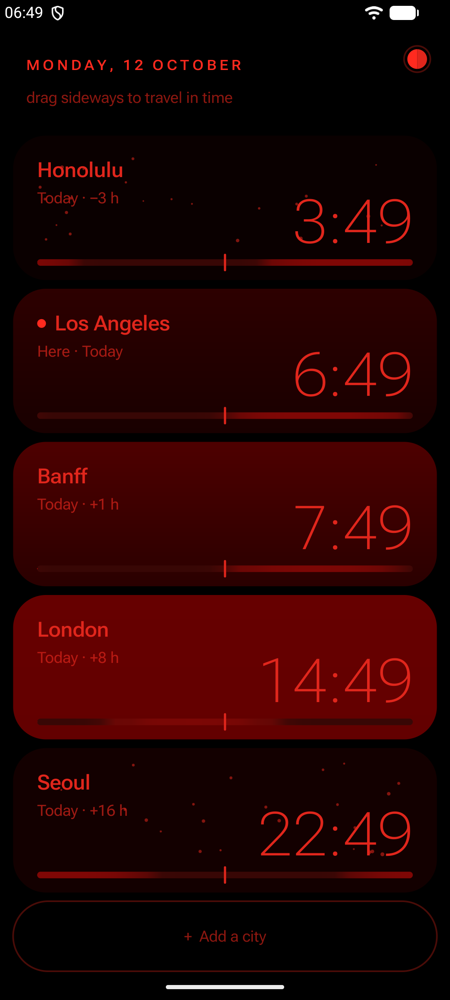
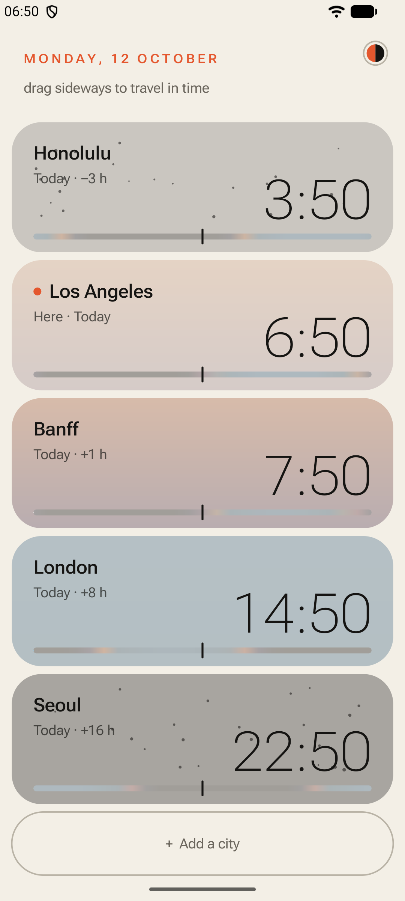

# World

**Your cities as live skies. Drag sideways to see everyone's time at once.**

A world clock where every city is a window onto its sky. Sunrise, noon, dusk and night come from the sun's real position, so you can tell at a glance who's awake.

     

## Features

- Each card is coloured by the sun's elevation in that city right now, with stars after dark and a 24-hour daylight strip underneath.
- Drag sideways to move time for every city at once (15-minute steps). A chip shows how far you've gone; tap it to come back to now.
- Cities are sorted by UTC offset, each labelled Today, Tomorrow or Yesterday with its difference from you.
- About 150 built-in cities and every IANA time zone work fully offline.
- Any other town ("Hilo, HI", "Banff, AB") is found through Open-Meteo's free geocoder, which also returns its time zone. Only the typed name is sent.
- Long-press a city to remove it. Long-press your own card to rename it or hide it.
- Seven themes, switched by tapping the dot at the top right: You (Material You colours from your wallpaper), Night (pure AMOLED black and red, for the dark), Auto (Night from 21:00 to 07:00, You otherwise), Mono, Ember, Glacier and Paper (light).

Tiny (under 100 KB), with no ads, tracking or analytics, and no dependency on Google Play Services. Needs Android 13 or newer.

## Install

- **GitHub:** download the APK from the [latest release](https://github.com/robbie-med/world_clock/releases/latest).
- **Obtainium:** add `https://github.com/robbie-med/world_clock` to get updates automatically.
- **F-Droid:** not listed yet. The repo is ready for it: plain Gradle with no proprietary libraries, a version tag per release, and store metadata in `fastlane/`.

Release APKs are signed with this certificate (SHA-256):

```
27:77:55:ce:89:82:9c:ad:ea:1c:f7:c7:6a:1e:44:be:7f:ef:3a:38:8c:49:94:8a:95:b1:0a:d4:f4:93:54:42
```

Check it with `apksigner verify --print-certs World-1.0.apk`.

## Permissions

| Permission | Why |
|---|---|
| `INTERNET` | Only to look up towns that aren't built in. Everything else works with network access off. |

## Build

Needs JDK 17 and the Android SDK (platform 36).

```sh
./gradlew assembleRelease
```

The APK lands in `app/build/outputs/apk/release/`. It is unsigned unless a `keystore.properties` file exists in the repo root with `storeFile`, `storePassword`, `keyAlias` and `keyPassword` (it is gitignored).

The code is plain Kotlin on the Android framework: no AndroidX, no Compose, no third-party libraries. `core/` holds the shared drawing, theme and typography code, and `app/` the app itself.

## Siblings

[Timer](https://github.com/robbie-med/timer) · [Alarm](https://github.com/robbie-med/alarm): the same look, each doing one job.

## License

[GPL-3.0-or-later](LICENSE). Package: `org.robbiemed.zones`.
